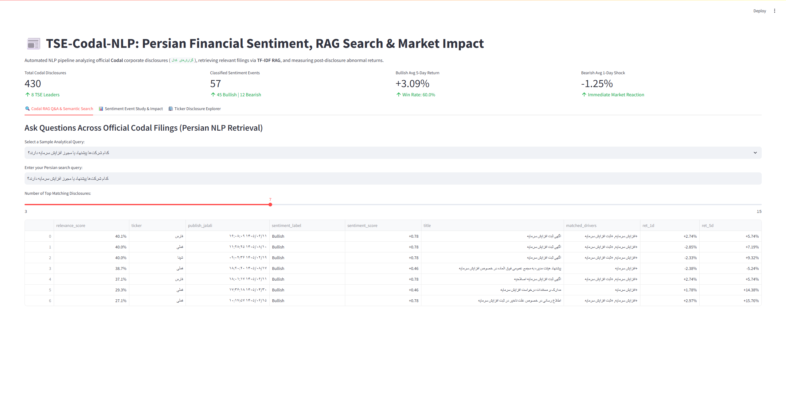

# 📰 TSE-Codal-NLP: Persian Financial Sentiment, RAG Search & Market Impact

An end-to-end **Persian Natural Language Processing (NLP)** and financial event-study pipeline built for **Codal** (`codal.ir`) corporate disclosures on the Tehran Stock Exchange (TSE). The system normalizes Persian regulatory filings, extracts fundamental sentiment drivers, provides a **TF-IDF + Cosine Similarity RAG** search interface, and measures post-disclosure abnormal stock returns.



---

## 🎯 Key Quantitative & NLP Features

* **Persian Financial Text Normalization (`src/persian_fin_nlp.py`):** Cleans HTML tags, unifies Arabic/Persian Unicode glyphs (`ي/ی`, `ك/ک`, ZWNJ), and scores disclosures using a weighted domain lexicon tailored to Codal regulatory filings.
* **RAG Semantic Retrieval Engine (`CodalRAGEngine`):** Vectorizes disclosures with sublinear TF-IDF (`1–2 n-grams`) to answer natural-language Persian analytical queries across corporate filings.
* **Market-Hours-Aware Alignment (`src/codal_loader.py`):** Converts Jalali publication timestamps to Gregorian trading dates and shifts post-close announcements (`>= 12:30 PM` Tehran time) to the next active trading session (`t+1`) to eliminate look-ahead bias.
* **Statistical Impact Validation (`src/impact_analyzer.py`):** Evaluates 1-day, 3-day, and 5-day post-disclosure returns across Bullish, Neutral, and Bearish filings using Welch’s t-test.

---

## 🚀 Quickstart

```bash
pip install -r requirements.txt
python -m pytest
python -m src.codal_loader
streamlit run app.py